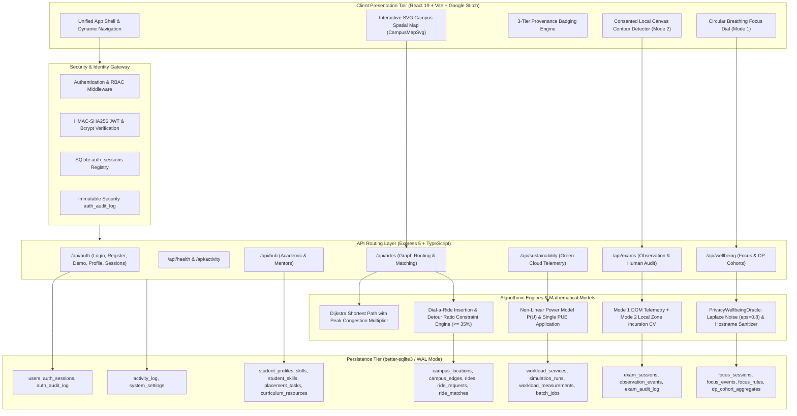

# UniVerse: System Architecture & Technical Specifications

> **Product**: UniVerse — Intelligent, Sustainable, and Privacy-Aware Campus Ecosystem  
> **Architecture**: Modular Monolith (TypeScript + Express 5 + SQLite WAL + React 19 + Google Stitch UI)  
> **Status**: Verified Runnable Implementation (190 / 190 tests passing)  

---

## 1. Executive Architecture Overview

UniVerse is engineered as a unified campus operating system built on a modern **modular monolith architecture**. It provides single-binary portability with zero external cloud dependencies or paid API keys, utilizing:
- **Presentation Tier**: React 19, TypeScript, Vite, Tailwind CSS v4, Lucide Icons, and Recharts, styled strictly with Google Stitch collegiate brutalist tokens (`#faf9f5` Warm Paper, `#1b1c1a` Ink Black, `#003fe1` High-Contrast Cobalt, zero-radius orthogonal borders).
- **Service Tier**: Express 5 with strictly typed request/response contracts, input validation, and centralized error handling.
- **Data Persistence**: `better-sqlite3` with Write-Ahead Logging (`WAL`), foreign key constraints, and immediate ACID transactions across 28 relational tables.
- **Authentication & Security**: 10-round salted Bcrypt password hashing, signed HMAC-SHA256 JWT access tokens, database session registry (`auth_sessions`), and append-only security audit logging (`auth_audit_log`).
- **Algorithmic Oracles**: Decoupled mathematical modules executing Dijkstra routing, Dial-a-Ride detour bounds, non-linear server power modeling, Laplace differential privacy, and responsible observation state machines.

---

## 2. Full-Stack System Architecture Diagram

---

## 3. Provenance Tracking & Responsible AI Principles

To prevent deceptive artificial intelligence claims, every card and visual metric in UniVerse is tagged with an immutable provenance tier:

| Provenance Tag | Definition | Example in UniVerse |
| :--- | :--- | :--- |
| **`ACTUAL_INFERENCE`** | Deterministic algorithmic outputs or local computer vision inference. | Dijkstra shortest path routes, Laplace noise injection, client-side webcam spatial box tracking. |
| **`SIMULATED_EVENT`** | Controlled, realistic events injected to demonstrate system behavior without production extensions. | Browsing URL events, candidate proctoring observation feeds, synthetic service traffic spikes. |
| **`ESTIMATED_METRIC`** | Derived metrics calculated via transparent mathematical models with documented assumptions. | Power draw $P(U)$ with PUE, regional grid carbon emissions ($g\text{ CO}_2\text{e}$), avoided travel emissions. |

---

## 4. Database Schema Structure (28 Relational Tables)

The SQLite database (`server/data/universe.db`) runs with `PRAGMA foreign_keys = ON;` and `PRAGMA journal_mode = WAL;`.

1. **Security & Core Node Identity**: `users`, `auth_sessions`, `auth_audit_log`.
2. **Module A (Academic Hub)**: `student_profiles`, `skills`, `student_skills`, `placement_tasks`, `mentor_profiles`, `mentorship_requests`, `curriculum_resources`.
3. **Module B (Ride-Pooling)**: `campus_locations`, `campus_edges`, `rides`, `ride_requests`, `ride_matches`.
4. **Module C (Sustainable Computing)**: `workload_services`, `simulation_runs`, `workload_measurements`, `batch_jobs`.
5. **Module D (Digital Wellbeing)**: `focus_sessions`, `focus_events`, `focus_rules`, `dp_cohort_aggregates`.
6. **Module E (Exam Monitoring)**: `exam_sessions`, `observation_events`, `exam_audit_log`.
7. **System Core**: `activity_log`, `system_settings`.

---

## 5. Security & Privacy Safeguards

- **Right to Erasure (GDPR / Digital Data Protection)**: Full user history purge endpoint (`DELETE /api/wellbeing/purge`) that permanently cascades deletion through sessions and events.
- **Local Hostname Sanitization**: Browsing URLs are parsed on the client to strip all tokens, passwords, query parameters, and URL fragments before ingestion (`leetcode.com/problems/x?token=123` $\to$ `leetcode.com`).
- **Zero Automated Discipline**: Observable examination flags require a human proctor's written rationale to resolve. No student is ever penalized automatically by computer vision.
