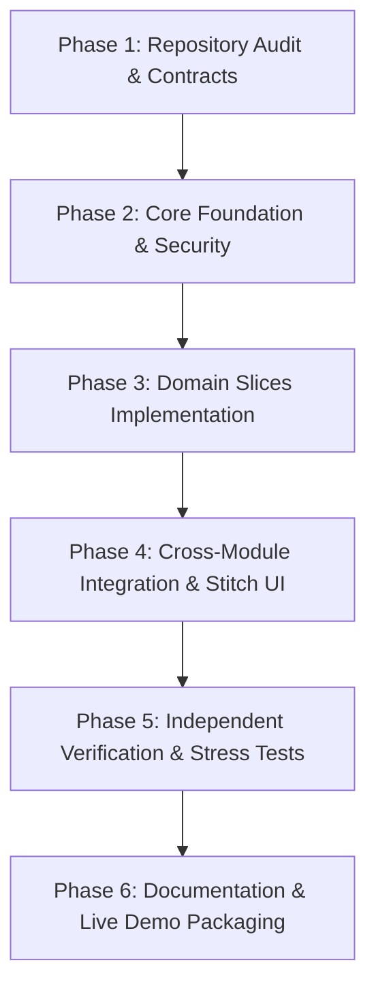

# UniVerse Engineering Build Plan & Implementation Roadmap

> **Product**: UniVerse — Intelligent, Sustainable, and Privacy-Aware Campus Ecosystem  
> **Architecture**: Modular Monolith (TypeScript + Express 5 + SQLite WAL + React 19 + Google Stitch UI)  

---

## 1. Objectives & Non-Negotiable Engineering Rules

1. **Inspect Before Editing**: Preserve all working code and user modifications. Verify baseline behavior before making changes.
2. **Single Cohesive Platform**: Deliver one integrated platform with unified navigation, shared authentication, and relational data integrity across all 5 modules—not five disconnected apps.
3. **Rigorous Licensing Compliance**: Use only approved permissive open-source models (MIT/Apache 2.0). Exclude non-commercial research code (e.g., ExMAS direct code) and invasive biometrics (e.g., Proctora webcam facial tracking).
4. **Honest Provenance Disclosure**: Every metric and event must carry an explicit label:
   - `[ACTUAL INFERENCE]`
   - `[SIMULATED EVENT]`
   - `[ESTIMATED METRIC]`
5. **Human-in-the-Loop Ethics**: Machine intelligence serves as an advisory assistant; no automated disciplinary determinations or black-box rankings.

---

## 2. Six-Phase Implementation Sequence

### Phase 1: Repository Audit & Contracts
- **Audit existing codebase**: Inspect Express version, SQLite connection lifecycle, database schemas, and dependencies.
- **Define API Contracts**: Formalize request/response envelopes, error codes, and TypeScript shared interfaces in `server/src/types`.
- **Review Open-Source Repositories**: Audit licenses, dependencies, and setup complexity for ScholarOS, Proctora, Cloud Carbon Footprint, Focuser, and ExMAS.

### Phase 2: Core Foundation & Security
- **Relational Storage**: Configure `better-sqlite3` in Write-Ahead-Log (WAL) mode with foreign key enforcement and idempotent seeding (`server/src/db/seed.ts`).
- **Full-Depth Authentication Engine**:
  - 10-round salted Bcrypt password hashing (`bcryptjs`).
  - Signed HMAC-SHA256 JWT access tokens (`jsonwebtoken`).
  - Database-backed session registry (`auth_sessions`) and append-only audit trail (`auth_audit_log`).
  - 4 Seeded Demo Personas: Student Scholar, Transit Driver, Exam Proctor, Central Admin.
  - Role-Based Access Control (RBAC) middleware (`requireAuth`, `requireRole`).

### Phase 3: Five Functional Domain Slices
- **Slice A (Academic Hub)**:
  - Skill inventory tree with competency ratings.
  - Placement milestone checklist with derived progress percentage.
  - Peer mentorship directory with cosine affinity scoring and request workflows.
  - Sovereign curriculum archive with downloadable academic resources.
- **Slice B (Campus Transit)**:
  - 10-node campus topological network with 30 directed edges.
  - Dijkstra shortest path minimum-priority queue algorithm: $O((V + E) \log V)$.
  - Detour insertion evaluator with hard ceiling: $\Delta t \le 35\%$.
  - Atomic seat reservations and driver route publishing.
- **Slice C (Sustainable Computing)**:
  - Telemetry simulation for 3 campus services.
  - Non-linear cubic power scaling equation: $P(U) = P_{\text{idle}} + (P_{\text{max}} - P_{\text{idle}})(U/100)^{1.25}$.
  - Facility energy calculation applying PUE (1.12–1.45) exactly once.
  - Baseline vs. Eco-Mode scenario comparisons.
  - Diurnal solar peak batch job scheduling simulation.
- **Slice D (Digital Wellbeing)**:
  - 4-state focus session state machine (`idle`, `running`, `paused`, `completed`).
  - Client-side regex hostname extraction (stripping query parameters and paths).
  - Laplace Differential Privacy mechanism ($\epsilon = 0.8$, $\Delta f = 1.0$) for cohort statistics.
  - GDPR Right-to-Erasure one-click data purge control.
- **Slice E (Responsible Exam Review)**:
  - **Mode 1**: Deterministic DOM window blur and fullscreen departure tracking.
  - **Mode 2**: Local consented canvas contour detector for `RESTRICTED_ZONE_INCURSION` and `MULTIPLE_OCCUPANTS_DETECTED`.
  - Human proctor adjudication queue requiring mandatory written rationale before resolution.
  - Append-only `exam_audit_log`.

### Phase 4: Google Stitch Design System & Public Narrative
- Rebuilt frontend based on Google Stitch collegiate export (`/Users/divya/Downloads/stitch_universe_campus_ecosystem_prototype`):
  - Tokens: `#faf9f5` Warm Paper, `#1b1c1a` Ink Black, `#003fe1` Cobalt, zero-radius containers (`rounded-none`).
  - Typography: Epilogue (headings), Geist (body), JetBrains Mono (metrics and code).
- Public Portal Pages:
  - `/` (Manifesto & Campus Constellation SVG)
  - `/how-it-works` (3-stage staged orchestration flow)
  - `/about` (Five Foundational Tenets)
  - `/impact` (Empirical ESG metrics)
  - `/onboarding` (3-step collegiate role & focus wizard)
  - `/login` (SSO & 1-click persona launcher)
  - `/app` (Integrated operational dashboard)

### Phase 5: Independent Verification & Adversarial Testing
- Verify full suite of 190 tests across 12 test suites:
  - Unit tests: Auth, Graph Matching, Energy/Carbon, Privacy DP.
  - Adversarial tests: Milestone 1, Milestone 2, Ride UI Stress.
  - Integration & E2E: Tier 1 Features, Tier 2 Boundaries, Tier 3 Pairwise, Tier 4 Scenarios, Full Ecosystem.
- Production build validation (`npm run build`).

### Phase 6: Documentation & Live Demonstration Package
- Complete reference documentation in `docs/`.
- Step-by-step judge demonstration guide in `docs/DEMO_SCRIPT.md`.
- Hackathon pitch summary in `docs/PITCH.md`.
