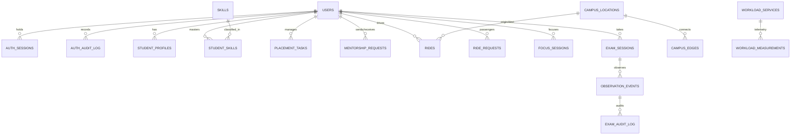

# UniVerse Relational Data Model & SQLite WAL Schema

> **Storage Engine**: `better-sqlite3` v13.0.3  
> **Database File**: `server/data/universe.db`  
> **Journal Mode**: `WAL` (Write-Ahead Logging)  
> **Foreign Keys**: `PRAGMA foreign_keys = ON`  

---

## 1. Schema Architecture & Entity Relationship Diagram



---

## 2. Table Directory (28 Relational Entities)

### Group 1: Core Node Identity & Cryptographic Security
1. `users`: Master node identity (`id`, `name`, `email`, `password_hash`, `role`, `department`, `year_of_study`, `bio`, `is_active`, `last_login`, `created_at`, `updated_at`).
2. `auth_sessions`: Active cryptographic session tokens (`id`, `user_id`, `token_hash`, `ip_address`, `user_agent`, `expires_at`, `is_revoked`, `last_active_at`, `created_at`).
3. `auth_audit_log`: Security audit trail (`id`, `user_id`, `email`, `event_type`, `ip_address`, `user_agent`, `metadata`, `created_at`).

### Group 2: Module A — Academic Placement & Mentorship Hub
4. `student_profiles`: Student academic metadata (`id`, `user_id`, `target_role`, `placement_goals`, `readiness_score`, `gpa`, `created_at`).
5. `skills`: Campus technical competency catalog (`id`, `name`, `category`, `prerequisite_skill_id`, `created_at`).
6. `student_skills`: Verified student skill proficiencies (`id`, `user_id`, `skill_id`, `rating`, `updated_at`).
7. `placement_tasks`: Placement readiness checklists (`id`, `user_id`, `title`, `category`, `is_completed`, `due_date`, `created_at`).
8. `mentor_profiles`: Peer mentor availability and focus areas (`id`, `user_id`, `specialty`, `hourly_capacity`, `affinity_vector`).
9. `mentorship_requests`: Peer mentorship invitation lifecycle (`id`, `student_id`, `mentor_id`, `topic`, `status`, `notes`, `created_at`).
10. `curriculum_resources`: Sovereign academic course archive (`id`, `course_code`, `title`, `subject`, `file_format`, `download_url`, `created_at`).

### Group 3: Module B — Campus Transit & Ride-Pooling
11. `campus_locations`: 10 topological nodes (`id`, `name`, `code`, `coord_x`, `coord_y`, `hub_type`).
12. `campus_edges`: 30 directed graph connections (`id`, `origin_id`, `destination_id`, `distance_km`, `base_travel_time_min`, `weight`).
13. `rides`: Active driver itineraries (`id`, `driver_id`, `origin_id`, `destination_id`, `departure_time`, `total_seats`, `available_seats`, `max_detour_percent`, `status`, `created_at`).
14. `ride_requests`: Commuter ride pool requests (`id`, `passenger_id`, `origin_id`, `destination_id`, `pickup_time`, `status`, `created_at`).
15. `ride_matches`: Algorithmically matched rides (`id`, `ride_id`, `request_id`, `detour_distance_km`, `detour_time_min`, `detour_ratio`, `status`, `created_at`).

### Group 4: Module C — Sustainable Computing Observatory
16. `workload_services`: The 3 modeled campus services (`id`, `name`, `service_code`, `base_idle_power_w`, `peak_power_w`, `power_model_exponent`).
17. `simulation_runs`: Recorded benchmark scenarios (`id`, `scenario_name`, `mode`, `pue_applied`, `grid_intensity_g_kwh`, `created_at`).
18. `workload_measurements`: Time-series power and carbon telemetry (`id`, `service_id`, `simulation_id`, `utilization_percent`, `power_draw_w`, `energy_kwh`, `carbon_emissions_g`).
19. `batch_jobs`: Simulated Slurm HPC job queue (`id`, `job_name`, `estimated_runtime_hours`, `required_power_w`, `is_solar_window`, `scheduled_at`).

### Group 5: Module D — Privacy-Aware Digital Wellbeing
20. `focus_sessions`: Student focus intervals (`id`, `user_id`, `target_duration_mins`, `actual_duration_seconds`, `status`, `started_at`, `stopped_at`, `deep_work_index`).
21. `focus_events`: Sanitized browsing entries (`id`, `session_id`, `sanitized_domain`, `category`, `duration_seconds`, `created_at`).
22. `focus_rules`: User domain classification rules (`id`, `user_id`, `domain_pattern`, `category`, `is_blocked`).
23. `dp_cohort_aggregates`: Differential privacy cache records (`id`, `cohort_identifier`, `true_mean`, `perturbed_mean`, `epsilon`, `sensitivity`, `created_at`).

### Group 6: Module E — Responsible Examination Review
24. `exam_sessions`: Scheduled examinations (`id`, `course_id`, `title`, `student_id`, `scheduled_start`, `scheduled_end`, `status`).
25. `observation_events`: Flagged exam incidents (`id`, `exam_session_id`, `event_type`, `confidence_score`, `provenance`, `frame_snapshot_url`, `review_status`, `proctor_notes`, `reviewer_id`, `timestamp`, `resolved_at`).
26. `exam_audit_log`: Append-only proctor adjudication ledger (`id`, `event_id`, `exam_session_id`, `proctor_id`, `previous_status`, `new_status`, `action`, `reason_code`, `proctor_notes`, `timestamp_utc`).

### Group 7: Shared Cross-Module Activity & System Telemetry
27. `activity_log`: Global campus activity feed (`id`, `user_id`, `module`, `action`, `details`, `timestamp`).
28. `system_settings`: Node-level configuration parameters (`key`, `value`, `updated_at`).

---

## 3. SQLite WAL Configuration & Performance Tuning

UniVerse configures SQLite via `server/src/db/connection.ts` on startup:
```sql
PRAGMA journal_mode = WAL;
PRAGMA synchronous = NORMAL;
PRAGMA foreign_keys = ON;
PRAGMA temp_store = MEMORY;
PRAGMA cache_size = -64000; -- 64MB memory cache
```
- **Concurrency**: WAL allows concurrent readers to proceed without blocking writers, and writers do not block readers.
- **Atomicity**: Multi-entity bookings (e.g., matching a ride and updating seat capacity) execute inside strict `db.transaction()` closures.
