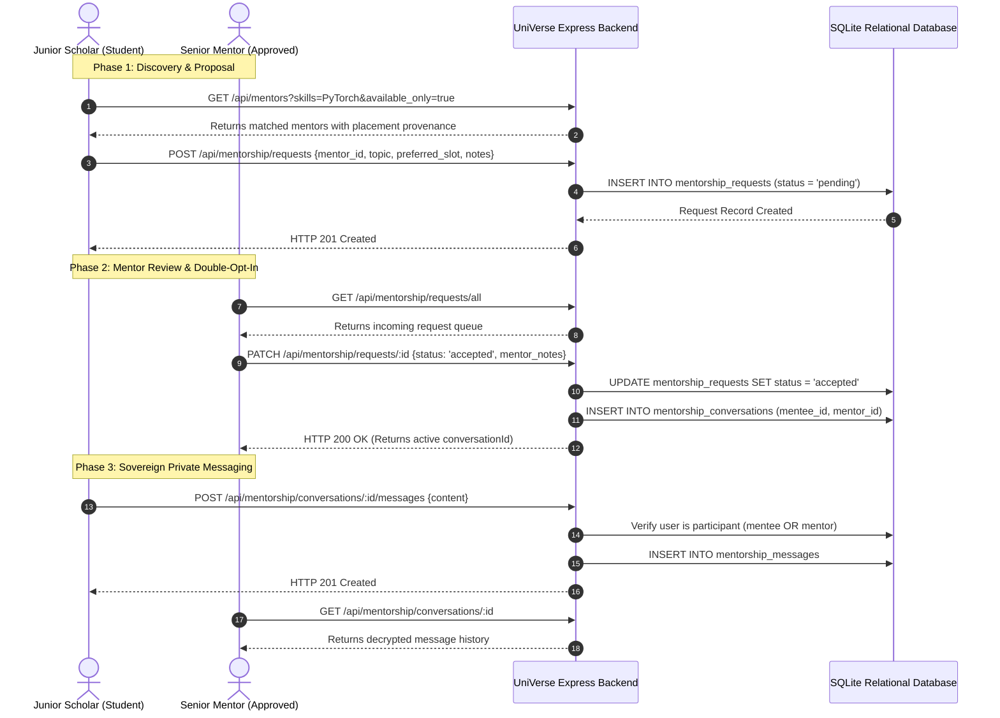

# UniVerse Senior-to-Junior Mentorship Architecture & Workflow

## 1. Executive Summary

The UniVerse Mentorship Network bridges graduating senior scholars holding top-tier placement offers with junior students seeking technical interview preparation, project guidance, and resume critique.

Unlike commercial advising marketplaces, UniVerse operates on a **zero-arbitrage peer protocol**:
- Mentorship is completely free of hourly fees or commissions.
- Mentors are verified through campus placement records (`placement_records`).
- Direct private messaging is strictly gatekept: a student cannot message a mentor until the mentor explicitly reviews and accepts the student's mentorship request.

---

## 2. End-to-End Mentorship Lifecycle

---

## 3. Security & Anti-Harassment Safeguards

1. **Unsolicited Message Prevention**:
   - Calling `POST /api/mentorship/conversations/:id/messages` without an existing conversation returns `404 Not Found`.
   - Creating a conversation requires an accepted `mentorship_requests` record. Students cannot directly initiate a conversation without mentor consent.
2. **Conversation Confidentiality**:
   - Every request to `/api/mentorship/conversations/:id` checks:
     `conv.mentee_id === req.user.sub || conv.mentor_id === req.user.sub`
   - Third-party users attempting access receive HTTP `403 Forbidden`.
3. **Availability & Capacity Caps**:
   - Each mentor defines `max_mentees` (default: 3-5). When `active_mentees >= max_mentees`, the mentor's profile displays "Cohort Full (Waitlist)" and rejects new request submissions until active sessions conclude.
