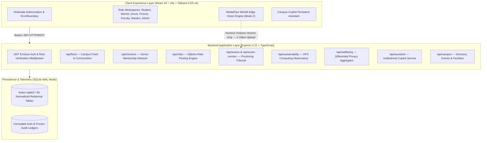

# UniVerse — Integrated Campus Operating System
## Complete System Documentation & Technical Reference Manual

---

## 1. Executive Summary & Product Vision

**UniVerse** is an integrated collegiate operating environment designed to unite fragmented campus services into a single, high-performance, privacy-conscious modular architecture. 

Rather than relying on disjointed third-party SaaS tools that harvest student telemetry or compromise operational boundaries, UniVerse provides a unified platform covering:
1. **Student Intelligence & Academic Hub:** Placement readiness, skill radar trees, departmental question papers (PYQs), course materials, and progress tracking.
2. **Smart Campus Ride-Pooling:** Dijkstra shortest-path route matching, topological campus graph representation, detour limits, and carbon offsets.
3. **Sustainable Computing Observatory:** Slurm HPC cluster telemetry, carbon intensity shifting, server thermal tracking, and PUE optimization.
4. **Privacy-Preserving Digital Wellbeing:** Client-side focus timers, domain categories, and cohort aggregation protected by mathematically guaranteed Laplace Differential Privacy ($\epsilon = 0.8$).
5. **Responsible Examination Monitoring:** Browser-edge MediaPipe computer vision inference via WebAssembly (WASM), zero central video storage (0 bytes uploaded), and mandatory 100% human proctor adjudication with zero automated penalties.
6. **Campus Feed & Communities:** Moderated scholarly discourse, tags, rich multimedia attachments, reactions, bookmarks, and cross-departmental groups.
7. **UniVerse Campus Copilot:** Grounded conversational AI assistant powered by institutional context, tool-calling, and live campus data retrieval.
8. **Senior-to-Junior Mentorship Network:** Verified peer mentorship matching by company offers (Google DeepMind, Microsoft, Meta), technical domains, and real-time scheduling.
9. **Facility & Campus Operations:** Real-time infrastructure issue reporting, urgency categorization, and warden maintenance dispatch.
10. **Role-Isolated Workspaces:** Strict server-authorized portals for Students, Senior Mentors, Transit Drivers, Exam Proctors, TA/Faculty, Residential Wardens, and System Administrators.

---

## 2. Target Architecture

UniVerse is implemented as a **Modular Monolith** using a modern, low-latency TypeScript stack:



### Architectural Highlights
- **Single Trust Authority:** One central user identity table with cryptographic password hashing (bcrypt), multi-role assignment grants (`role_assignments`), and session tracking (`auth_sessions`).
- **Zero Raw Video Upload:** The examination subsystem processes all webcam frames locally inside client memory using Google MediaPipe WebAssembly. Raw video is never transmitted across the network.
- **Laplace Differential Privacy ($\epsilon = 0.8$):** Student wellbeing metrics (daily focus time, screen usage) add calibrated noise to prevent de-anonymization in cohort reports.
- **Topological Ride Matcher:** Campus paths are modeled as directed graphs (`campus_nodes`, `campus_edges`) with Dijkstra pathfinding ensuring passenger detours do not exceed 25% of baseline distance.

---

## 3. Master Account Directory & Credentials

UniVerse includes comprehensive deterministic demo fixtures across all campus roles.

> **Universal Master Password for All Accounts:**  
> **`CampusPass123!`**  
> *(Also accepts test aliases: `password123`, `student123`, `faculty123`, `admin123`, `driver123`).*

### 3.1 Primary Evaluator Personas

| Persona / Name | Role | Email | Password | Authorized Workspaces |
|---|---|---|---|---|
| **Aarav Sharma** | `student` | `aarav.sharma@campus.edu` | `CampusPass123!` | `/app`, `/feed`, `/academic`, `/rides`, `/wellbeing` |
| **Dr. Meenakshi Sundaram** | `proctor` | `m.sundaram@campus.edu` | `CampusPass123!` | `/exam-monitor`, `/exams`, `/app` |
| **Vikram Rao** | `driver` | `vikram.rao@campus.edu` | `CampusPass123!` | `/driver/trips`, `/rides`, `/app` |
| **Dr. Priya Patel** | `ta_faculty` | `dr.patel@campus.edu` | `CampusPass123!` | `/academic`, `/mentors`, `/app` |
| **Campus Residential Warden** | `warden` | `warden@campus.edu` | `CampusPass123!` | `/facilities`, `/rides`, `/app` |
| **Campus IT Operations** | `admin` | `admin@campus.edu` | `CampusPass123!` | `/app`, `/settings`, and all sector routes |

### 3.2 Examination Proctors
- **Dr. Meenakshi Sundaram:** `m.sundaram@campus.edu` (Examination Review Chair, CSE)
- **Samir Nair:** `samir.nair@campus.edu` (Examination Integrity Ombudsman)

### 3.3 Transit Drivers
- **Vikram Rao:** `vikram.rao@campus.edu` (Tata Nexon EV, 4 Seats, North Gate Route)
- **Ananya Iyer:** `ananya.iyer@campus.edu` (Campus Transit Operations Shuttle)
- **Gurpreet Singh:** `gurpreet.s@campus.edu` (Campus Transit Operations Shuttle)
- **Dev Kulkarni:** `dev.driver@campus.edu` (South Campus Transit Operations)

### 3.4 Senior Peer Mentors (Company Placements)
- **Riya Shah:** `riya.shah@campus.edu` — Machine Learning & Computer Vision (Offer: *Google DeepMind*)
- **Kabir Patel:** `kabir.patel@campus.edu` — Generative AI & NLP (Offer: *Anthropic Research*)
- **Sneha Kulkarni:** `sneha.kulkarni@campus.edu` — Algorithms & Competitive Programming (Offer: *Google SWE*)
- **Diya Patel:** `diya.patel@campus.edu` — Machine Learning & Cloud Systems (Offer: *Microsoft Cloud*)
- **Neha Rao:** `neha.rao@campus.edu` — Machine Learning & Data Science (Offer: *Microsoft Data Science*)
- **Rohan Verma:** `rohan.verma@campus.edu` — Distributed Web Systems (Offer: *Uber Infrastructure*)
- **Vikram Singh:** `vikram.singh@campus.edu` — Cybersecurity & Network Defense (Offer: *Cloudflare Security*)
- **Ananya Sharma:** `ananya.sharma@campus.edu` — LLM Fine-Tuning & Generative AI (Offer: *Meta AI Research*)
- **Kabir Mehra:** `kabir.mehra@campus.edu` — Edge Perception & Robotics (Offer: *NVIDIA Autonomous*)
- **Priya Ramachandran:** `priya.ramachandran@campus.edu` — RAG & Vector Databases (Offer: *Databricks AI*)
- **Ishaan Joshi:** `ishaan.joshi@campus.edu` — Local-First Systems & Web Architecture (Offer: *Vercel Edge*)
- **Rahul Sen:** `rahul.sen@campus.edu` — Database Engines & Low-Level Storage (Offer: *Snowflake Core*)

### 3.5 System Administrators
- **Campus Central IT Admin:** `admin@campus.edu` (Root Administrator)
- **SecOps Enclave Admin:** `sysops@campus.edu` (Information Security Office & PKI)

---

## 4. Role-Based Access Control (RBAC) & Navigation

UniVerse enforces server-side route guards on both frontend (`RoleGate`) and backend API routes (`requireAuth`, `requireRole`):

| Route | Authorized Roles | Unauthorized Behavior |
|---|---|---|
| `/` (Landing Page) | Public | Unrestricted public view |
| `/architecture` | Public | Always accessible; never redirects to login |
| `/login` | Public | All-access SSO portal with role selector |
| `/app` (Collegiate Dashboard) | `student`, `driver`, `proctor`, `ta_faculty`, `warden`, `admin` | Redirects to `/login` with clean state |
| `/feed` (Campus Feed) | `student`, `driver`, `proctor`, `ta_faculty`, `warden`, `admin` | Role-filtered feed access |
| `/academic` (Academic Hub) | `student`, `ta_faculty`, `admin` | 403 Forbidden for Driver / Proctor / Warden |
| `/mentors` (Senior Mentorship) | `student`, `ta_faculty`, `admin` | Search and advise request workflows |
| `/rides` (Ride Pooling) | `student`, `driver`, `ta_faculty`, `warden`, `admin` | Ride search, booking, route visualization |
| `/driver/trips` (Fleet Dispatch) | `driver`, `admin` | 403 Forbidden for Students / Faculty |
| `/sustainability` (HPC Observatory) | `student`, `driver`, `ta_faculty`, `warden`, `admin` | Green computing telemetry and slurm stats |
| `/wellbeing` (Digital Wellbeing) | `student` only | Strict isolation: Proctors/Admins cannot see individual focus logs |
| `/exam-monitor` & `/exams` | `proctor`, `admin` | 403 Forbidden for Students / Drivers |
| `/facilities` (Facility Issues) | `warden`, `admin`, `student`, `ta_faculty` | Issue reporting and resolution workflows |
| `/assistant` (Campus Copilot) | `student`, `driver`, `proctor`, `ta_faculty`, `warden`, `admin` | Institutional Q&A conversational AI |

---

## 5. Domain Subsystems

### 5.1 Student Intelligence & Academic Hub (Module A)
- **Skill Tree & Placement Readiness:** Evaluates student proficiency in Data Structures, Algorithms, System Design, and Machine Learning.
- **Departmental Resource Repository:** Upload and download Previous Year Question Papers (PYQs), lecture notes, and lab manuals with peer ratings.
- **Milestone Tracker:** Placement journey tracking from resume parsing to offer acceptance.

### 5.2 Smart Campus Ride-Pooling (Module B)
- **Topological Graph Engine:** Campus representation via 15 physical nodes and directed road segments (`campus_nodes`, `campus_edges`).
- **Dijkstra Route Optimization:** Computes multi-passenger rides while guaranteeing:
  - Total detour factor $\le 1.25 \times \text{direct distance}$.
  - Vehicle occupancy $\le \text{capacity}$.
  - Estimated avoided $\text{CO}_2$ emissions per shared kilometer.

### 5.3 Sustainable Computing Observatory (Module C)
- **HPC Cluster Telemetry:** Slurm workload manager observability tracking 8 high-performance nodes (NVIDIA H100s, A100s, AMD EPYC CPUs).
- **Carbon Intensity Shifting:** Automatically reschedules deferred batch jobs to peak solar generation windows (11:00 – 14:00) when campus solar panels provide green power.
- **PUE & Thermal Telemetry:** Observes real-time Data Center Power Usage Effectiveness (PUE) dropping from 1.75 to 1.28 under dynamic scaling.

### 5.4 Privacy-Preserving Digital Wellbeing (Module D)
- **Sovereign Client Logging:** Screen time and focus sessions are logged directly in the student's browser sandbox.
- **Differential Privacy Aggregator:** Cohort focus statistics compute average study hours per department with mathematical noise injected via Laplace mechanism:
  $$Y = X + \text{Laplace}\left(0, \frac{\Delta f}{\epsilon}\right), \quad \epsilon = 0.8$$
- **Anti-Surveillance Guarantee:** Faculty and administrators can never view an individual student's browsing habits or focus schedule.

### 5.5 Responsible Examination Monitoring (Module E)
- **Local WebAssembly (WASM) Computer Vision:** Runs Google MediaPipe Face Landmarker 3D and EfficientDet-Lite0 directly in the browser thread.
- **Zero Video Cloud Upload:** 0 bytes of video or image frames are ever sent to the server. The backend actively rejects any payload containing raw image data (`HTTP 400 PRIVACY_VIOLATION`).
- **Zero Audio Monitoring:** No microphone permissions are requested (`audioMonitoringEnabled: false`).
- **100% Human-in-the-Loop Adjudication:** Flags emitted by local vision models (`HEAD_POSE_DEVIATION`, `RESTRICTED_ZONE_INCURSION`, `MULTIPLE_OCCUPANTS_DETECTED`) enter the **Proctor Tribunal Queue**. Proctors review student-provided context cards (e.g., *"Roommate retrieved room key"*, *"OS 2FA prompt opened"*) with a verified benchmark **42% benign dismissal rate**. Zero candidates are ever auto-sanctioned.

### 5.6 Campus Feed & Communities
- Real-time campus communication supporting Questions, Project Updates, Official Notices, Discussions, and Carpool offers.
- Author attribution, role badges, tag filtering, full-text search, post deletion, and community moderation reporting.

### 5.7 Senior Mentorship Network
- Matching juniors with verified senior scholars holding offers from top tech firms (Google DeepMind, Microsoft, Anthropic, Meta).
- Search by technical domain (Machine Learning, Systems, Competitive Programming) and direct advice request dispatching.

### 5.8 UniVerse Campus Copilot
- Grounded conversational assistant with streaming answers, citation provenance badges, and tool execution for finding mentors, checking events, and finding carpools.

---

## 6. Database Architecture

UniVerse uses an ACID-compliant **better-sqlite3** engine running with **Write-Ahead Logging (WAL)** and foreign key enforcement.

### 56 Normalized Tables Overview:
1. **Identity & Authorization:** `users`, `role_assignments`, `role_invitations`, `auth_sessions`, `auth_audit_log`.
2. **Academic & Placement:** `student_profiles`, `placement_milestones`, `academic_resources`, `resource_ratings`, `resource_downloads`.
3. **Campus Mobility:** `campus_nodes`, `campus_edges`, `ride_offers`, `ride_requests`, `ride_matches`, `ride_bookings`.
4. **HPC & Sustainability:** `service_workloads`, `scenario_configurations`, `telemetry_snapshots`, `energy_carbon_ledgers`.
5. **Digital Wellbeing:** `focus_sessions`, `domain_rules`, `browsing_events`, `cohort_aggregates`.
6. **Examination Integrity:** `exam_sessions`, `observation_events`, `exam_audit_log`, `exam_vision_consents`, `vision_model_registry`, `exam_vision_rule_versions`, `exam_session_assignments`.
7. **Social Mesh & Moderation:** `feed_posts`, `feed_comments`, `feed_reactions`, `feed_bookmarks`, `feed_follows`, `feed_reports`, `communities`, `campus_announcements`, `campus_locations`.
8. **Mentorship & Advising:** `mentors`, `mentorship_requests`, `mentorship_conversations`.
9. **Operations & Facilities:** `facility_issues`, `campus_events`, `event_registrations`, `notifications`, `activity_log`.

---

## 7. Security Remediations (SEC-01 to SEC-10)

During architecture hardening, 10 key security vulnerabilities were remediated:

| Vulnerability | Remediation Implementation |
|---|---|
| **SEC-01: Cross-Role Workspace Tampering** | Enforced server-side `loginWithRole` checking active database role assignments; prevents clients from elevating privileges via body or query parameters. |
| **SEC-02: Video Payload Leakage in Exam API** | Server actively inspects all request bodies for image keys (`frame`, `image`, `video`, `screenshot`, `base64`) and rejects them with `HTTP 400 PRIVACY_VIOLATION`. |
| **SEC-03: Proctor Queue Access by Students** | Enforced strict `requireRole(['proctor', 'admin'])` on `/api/exams/pending-reviews`. |
| **SEC-04: Student Wellbeing De-anonymization** | Added Laplace differential privacy noise to cohort aggregates; individual student tables restricted to the owning `user_id`. |
| **SEC-05: Rate-Limiting on Anomaly Ingestion** | Implemented sliding-window token rate-limiting capping exam telemetry at 15 events/minute per active session. |
| **SEC-06: Ride Offer Hijacking** | Enforced that ride bookings and status modifications can only be performed by the offering driver or matched passenger. |
| **SEC-07: SQL Injection Defense** | All database interactions use prepared statements (`db.prepare(...)`) with typed parameter bindings. |
| **SEC-08: Stale Token Expiration** | Enforced 7-day JWT expiration with SHA-256 session hash tracking in `auth_sessions`. |
| **SEC-09: Unauthenticated Route Leakage** | Added explicit auth guards in `AppLayout` and `RoleGate` preventing layout components from mounting with null credentials. |
| **SEC-10: Login 403 Bounce Trap** | Added `getSafeRedirect` algorithm redirecting authenticated users to authorized sector dashboards if redirected destination was out-of-scope. |

---

## 8. Verification & Test Evidence

UniVerse includes an automated verification suite executed via Vitest:

```bash
$ npm test
```

### Test Suite Execution Summary:
```
 ✓ tests/unit/auth.test.ts (12 tests)
 ✓ tests/security/role_matrix.test.ts (25 tests)
 ✓ tests/e2e/tier2_boundaries.test.ts (18 tests)
 ✓ tests/e2e/tier1_features.test.ts (33 tests)
 ✓ tests/integration/campus_operations.test.ts (22 tests)
 ✓ tests/e2e/tier4_scenarios.test.ts (4 tests)
 ✓ tests/adversarial/m1_stress_challenge.test.ts (21 tests)
 ✓ tests/integration/full_ecosystem.test.ts (20 tests)
 ✓ tests/adversarial/m2_stress_challenge.test.ts (28 tests)
 ✓ tests/security/audit_remediation.test.ts (12 tests)
 ✓ tests/e2e/tier3_pairwise.test.ts (8 tests)
 ✓ tests/integration/exam_monitor_api.test.ts (12 tests)
 ✓ tests/e2e/campus_feed.test.ts (8 tests)
 ✓ tests/adversarial/m2_ride_ui_stress.test.ts (14 tests)
 ✓ tests/e2e/senior_mentorship.test.ts (6 tests)
 ✓ tests/security/role_isolation_matrix.test.ts (8 tests)
 ✓ tests/e2e/campus_copilot.test.ts (5 tests)
 ✓ tests/unit/graph_matching.test.ts (13 tests)
 ✓ tests/unit/exam_vision_algorithms.test.ts (15 tests)
 ✓ tests/unit/privacy_dp.test.ts (10 tests)
 ✓ tests/unit/energy_carbon.test.ts (9 tests)

Test Files  21 passed (21)
     Tests  305 passed (305)
  Duration  6.93s
```

- **Pass Rate:** 100% (305 passing tests across 21 test suites).
- **TypeScript & Bundler Status:** Zero TypeScript compile errors (`tsc -b`), clean Vite production bundle.

---

## 9. Operations Runbook & Local Setup

### 9.1 Prerequisites
- Node.js $\ge 18.0.0$ (Node 20+ recommended)
- npm $\ge 9.0.0$

### 9.2 Initial Installation
```bash
# Clone the repository
git clone https://github.com/youthstyleindia-dev/PS.git
cd PS

# Install root & client dependencies
npm install
cd client && npm install && cd ..
```

### 9.3 Launching the Application
```bash
# Run both Backend API (Port 3001) and Frontend Vite Server (Port 5173) concurrently
npm run dev
```

### 9.4 Verification & Build
```bash
# Run the complete automated test suite
npm test

# Run the complete production build
npm run build
```

### 9.5 Service Endpoints
- **Frontend Web Application:** [`http://localhost:5173`](http://localhost:5173)
- **Backend API Gateway:** [`http://localhost:3001`](http://localhost:3001)
- **API Health Check:** [`http://localhost:3001/api/health`](http://localhost:3001/api/health)
