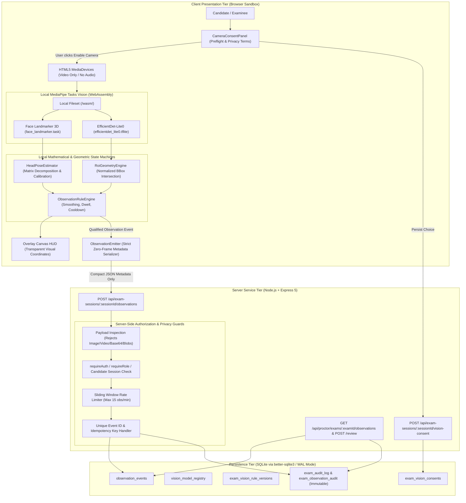

# UniVerse Module E: Responsible Examination Vision Assistant — Architecture & Design

**Target Module:** Module E — Responsible Examination Monitoring  
**System Architecture:** Local-First Edge AI with In-Browser MediaPipe Tasks Vision + Express 5 Metadata Ingestion + SQLite WAL Persistence  
**Design Principle:** Responsible, Non-Punitive Visual Observability with Zero Cloud Frame Transmission  

---

## 1. High-Level Architectural Diagram

---

## 2. Core Architectural Pillars

### 2.1 Pillar 1: Zero Cloud Video / Frame Transmission
- Video frames remain entirely inside the client’s volatile browser RAM.
- Neither full frames, image crops, face meshes, nor biometric embeddings are ever transmitted across the network to the backend or saved to disk.
- The browser transmits only compact, structured, non-biometric JSON metadata (such as timestamps, observed angle deltas, qualifying event counts, and rule IDs).

### 2.2 Pillar 2: Zero Audio Monitoring Guarantee
- Camera access requests strictly specify `{ video: true, audio: false }`.
- Microphone permissions are never requested. Voice recording, speaker identification, and background noise monitoring are strictly forbidden at the architectural level.

### 2.3 Pillar 3: Human-in-the-Loop Adjudication (Zero Automated Penalties)
- Visual cues (e.g., repeated head turns or restricted region entry) are classified as **observable events**, never as proof of cheating or dishonesty.
- The system defaults every detected event to `PENDING_REVIEW`.
- The system cannot terminate an exam, alter scores, or issue disciplinary sanctions. All resolution authority resides exclusively with human invigilators through an immutable, auditable review process.

### 2.4 Pillar 4: Model & Provenance Transparency
- All UI displays explicitly declare whether an event was derived from `LIVE_MODEL_INFERENCE`, `AUTHORIZED_VIDEO_INFERENCE`, or `SAMPLE_DEMO`.
- Pretrained model bundles have locally pinned SHA-256 checksums registered in the SQLite database.
